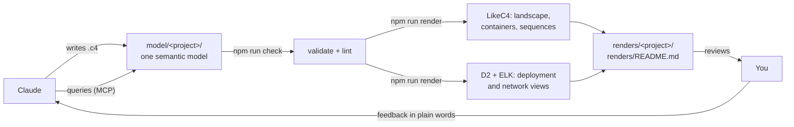

# Architecture

Architecture as code. Claude writes and maintains a semantic architecture **model**. You review the
**rendered diagrams**.

- **Review here:** [`renders/README.md`](renders/README.md): every diagram of every project, with title and description.
- **Model:** `model/<project>/**/*.c4` ([LikeC4](https://likec4.dev) DSL): elements, relationships, deployment and network.
- **Background:** [`docs/chats/open-source-architektursoftware.md`](docs/chats/open-source-architektursoftware.md)
  is the research chat that led to this setup.

## How it works



Every element exists once in the model, with a kind, a description, tags and metadata (VLAN, subnet, IP, ...).
Every relationship has a direction, a title and a technology. Diagrams are views that select parts of the model,
so the same "Order Service" is identical in the landscape, the container diagram, the checkout sequence and the
production deployment. Claude can ask the model questions like "what depends on the Event Bus?", "how does a
customer order reach the warehouse?" or "which VLAN does X run in?" without reading pictures.

## Projects

Each folder under `model/` with a `likec4.config.json` is a separate architecture. All of them share the
vocabulary in `model/shared/specification.c4`.

| Project | Content |
|---|---|
| `k8s-cluster` | Two physical servers, one VM each, Kubernetes on both (control plane + worker). Public ingress on the VMs' public IPs; cluster-internal traffic through a WireGuard tunnel. **IPs are placeholders.** |
| `trailhead` | Fictional outdoor-gear retailer, a reference example: landscape, containers, event flows, GDPR map, checkout and fulfilment sequences, production deployment, data-centre and office networks, site-to-site VPN |

## Working with Claude

Ask in plain language. For example:

- "Replace the placeholder IPs in the cluster with these: …"
- "Add a third node to the cluster and show me the network again."
- "What would be affected if the Event Bus is down for an hour?"
- "Draw the returns process as a scenario."

Claude follows `AGENTS.md` and the `architecture-diagrams` skill in `.claude/skills/`. It changes the model,
runs the checks, renders, looks at the images itself, and then points you to the files.

## Commands

| Command | What it does |
|---|---|
| `npm run setup` | First time on a machine: dependencies, the headless browser for LikeC4 rendering, and D2 (via Homebrew) |
| `npm run check` | LikeC4 validation + semantic lint (`scripts/check.mjs`) for every project |
| `npm run render` | Check, then render all views into `renders/<project>/` and regenerate `renders/README.md` |
| `npm run render -- -p <project> -f <viewId>` | Render only one project and/or the matching views (no cleanup) |
| `npm run serve` | Interactive diagram browser at http://localhost:5173 (zoom, click through, hover relationships) |
| `npm run format` | Format all `.c4` files |

### What the lint checks

LikeC4 itself checks syntax and references. `scripts/check.mjs` adds the rules that keep the model trustworthy:

- every element and deployment node has a description; every relationship has a title (warning if no technology)
- every element appears in at least one view
- async relationships go through a queue; overlay (in-tunnel) traffic names the tunnel that carries it
- every step of a scenario matches a real relationship in the model
- network zones have VLAN, CIDR and gateway; subnets don't overlap; VLAN ids are unique per site; gateways and
  host IPs sit inside their subnet
- interface IPs are written as address/prefix and are unique; both ends of a VPN tunnel are in the same subnet

## Optional: fewer permission prompts for Claude

Claude may not change its own permissions, so this is up to you. To let it run the checks, renders and model
queries without asking each time, create `.claude/settings.json`:

```json
{
  "enabledMcpjsonServers": ["likec4"],
  "permissions": {
    "allow": [
      "Bash(npm run check)",
      "Bash(npm run render)",
      "Bash(npm run render -- *)",
      "Bash(npm run format)",
      "Bash(npx likec4 *)",
      "Bash(node scripts/check.mjs*)",
      "mcp__likec4"
    ]
  }
}
```

## Why these tools

Chosen after the research in `docs/chats/` and after trying it on the first real architecture:

- **LikeC4 as the single model.** It's a real model, not just a drawing: software (C4), deployment and networks
  in one place, with CLI validation, an MCP server for agents, and an interactive viewer. MIT licensed. It also
  renders the landscape, container and sequence diagrams well.
- **D2 (with the ELK layout) renders deployment and network views.** LikeC4's Graphviz layout struggled with
  nested infrastructure (server → NIC/VM → interfaces → node → pods) and links across hosts. `scripts/d2.mjs`
  converts each deployment view into D2 and puts VLANs, subnets and IPs from the model into the labels. D2 is
  only the renderer, so there's still exactly one model.
- **No separate network tool (NetBox) yet.** It would need a server and a database. VLANs, subnets, hosts,
  interfaces and tunnels fit into LikeC4's deployment model with metadata, and the lint validates them. If real
  IPAM data ever needs a source of truth, NetBox can be added and exported into this model.
- **Not used:** Structurizr (open core, similar to LikeC4), PlantUML/Mermaid (no model behind the drawing),
  mingrammer Diagrams (Python, drawing only), Archi (heavy GUI tool, harder to automate).
