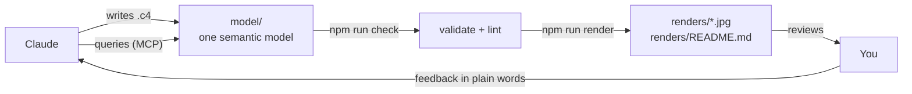

# Architecture

Architecture as code. Claude writes and maintains a semantic architecture **model**. You review the
**rendered diagrams**.

- **Review here:** [`renders/README.md`](renders/README.md): every diagram with its title and description.
- **Model:** `model/**/*.c4` ([LikeC4](https://likec4.dev) DSL): elements, relationships, deployment and network.
- **Background:** [`docs/chats/open-source-architektursoftware.md`](docs/chats/open-source-architektursoftware.md)
  is the research chat that led to this setup.

## How it works



Every element exists once in the model, with a kind, a description, tags and metadata. Every relationship has
a direction, a title and a technology. Diagrams are views that select parts of the model, so the same "Order
Service" is identical in the landscape, the container diagram, the checkout sequence and the production
deployment. Claude can ask the model questions like "what depends on the Event Bus?", "how does a customer
order reach the warehouse?" or "which VLAN does X run in?" without reading pictures.

The examples cover a fictional outdoor-gear retailer:

| Area | Views |
|---|---|
| Software | System landscape, shop context, shop and warehouse containers, event flows, monitoring |
| Scenarios | Checkout & payment, picking & shipping (sequence diagrams) |
| Cross-cutting | Personal data (GDPR) map, driven by the `#pii` tag |
| Infrastructure | Production deployment (what runs where), cross-site traffic |
| Network | Sites & WAN/VPN, data-centre VLANs and cabling, office/warehouse VLANs and Wi-Fi |

## Working with Claude

Ask in plain language. For example:

- "Add a mobile app for customers that uses the same order API."
- "Move the search index into its own VLAN and show me the new production network."
- "What would be affected if the Event Bus is down for an hour?"
- "Draw the returns process as a scenario."

Claude follows `AGENTS.md` and the `architecture-diagrams` skill in `.claude/skills/`. It changes the model,
runs the checks, renders, looks at the images itself, and then points you to the files.

## Commands

| Command | What it does |
|---|---|
| `npm run setup` | First time on a machine: install dependencies and the headless browser used for rendering |
| `npm run check` | LikeC4 validation + semantic lint (`scripts/check.mjs`) |
| `npm run render` | Check, then render all views to `renders/*.jpg` and regenerate `renders/README.md` |
| `npm run render -- -f <viewId>` | Render only matching views (no cleanup) |
| `npm run serve` | Interactive diagram browser at http://localhost:5173 (zoom, click through, hover relationships) |
| `npm run format` | Format all `.c4` files |

### What the lint checks

LikeC4 itself checks syntax and references. `scripts/check.mjs` adds the rules that keep the model trustworthy:

- every element and deployment node has a description; every relationship has a title (warning if no technology)
- every element appears in at least one view
- async relationships go through a queue
- every step of a scenario matches a real relationship in the model
- network zones have VLAN, CIDR and gateway; subnets don't overlap; VLAN ids are unique per site; gateways and
  host IPs sit inside their subnet

## Optional: fewer permission prompts for Claude

Claude may not change its own permissions, so this is up to you. To let it run the checks, renders and model
queries without asking each time, create `.claude/settings.json`:

```json
{
  "enabledMcpjsonServers": ["likec4"],
  "permissions": {
    "allow": [
      "Bash(npm run check)",
      "Bash(npm run render)",
      "Bash(npm run render -- *)",
      "Bash(npx likec4 *)",
      "mcp__likec4__*"
    ]
  }
}
```

## Why these tools

Chosen after the research in `docs/chats/`:

- **LikeC4** as the single model: it's a real model (not just a drawing), it can cover software (C4), deployment
  and network zones in one place, and it comes with CLI validation, PNG/JPG export, an MCP server for agents and
  an interactive viewer. It's MIT licensed.
- **No separate network tool (NetBox) yet.** It would need a server and a database. VLANs, subnets, hosts and
  cabling fit into LikeC4's deployment model with metadata, and the lint validates them. If this ever needs to
  become the source of truth for real IPAM data, NetBox can be added and exported into this model.
- **D2 / draw.io not needed**: LikeC4 can export to draw.io (`npx likec4 export drawio`) if a hand-edited
  drawing is ever wanted.
