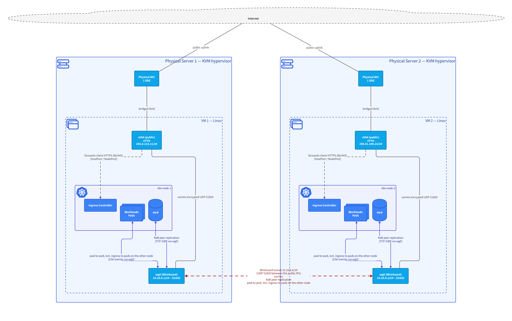

# architecture-kit

Architecture as code for [Claude Code](https://claude.com/claude-code). On request, Claude models your
software, infrastructure and networks as one semantic [LikeC4](https://likec4.dev) model inside your
repository, keeps it consistent with a lint, and renders diagrams for you to review. You read pictures; Claude
works on and queries the model.



*Rendered from [`examples/k8s-cluster/model/`](examples/k8s-cluster/model/). All views:
[`examples/k8s-cluster/renders/README.md`](examples/k8s-cluster/renders/README.md).*

## Commands

The plugin does nothing until you call it:

| Command | What it does |
|---|---|
| `/architecture-kit:architecture <request>` | Model, change, query or draw the architecture, e.g. *"two servers, one VM each, Kubernetes on both, cluster traffic through a WireGuard tunnel; draw the network with NICs, VMs and nodes"*. Sets up `.architecture-kit/` first if it's missing |
| `/architecture-kit:init [name] [title]` | Only set up `.architecture-kit/` in the repository |
| `/architecture-kit:review [view ids]` | Render the diagrams and have Claude check every image before handing them over |

Every command ends with a message telling you where the files are, for example:

```
Files are in .architecture-kit/ (/path/to/repo/.architecture-kit):
- Review index: .architecture-kit/renders/README.md
- Diagrams: .architecture-kit/renders/network.png, ...
- Model: .architecture-kit/model/deployment.c4, ...
```

## What the plugin contains

| Part | What it does |
|---|---|
| **Skills** `architecture`, `init`, `review` | The commands above. They only run when you call them (`disable-model-invocation`) and share one guide ([`guide/modelling.md`](guide/modelling.md)): conventions, element kinds, LikeC4 pitfalls, recipes, the edit → check → render → look-at-it loop |
| **MCP server** `likec4` | Lets Claude query the model: dependencies, paths between elements, impact analysis, metadata such as VLANs and IPs. It starts with every session but only finds something in repositories that have `.architecture-kit/` |
| **Hook** | After Claude edits a `.c4` file inside `.architecture-kit/`, the model is checked and errors go straight back to Claude. Edits to other files are ignored |
| **CLI** `architecture-kit` | `init`, `setup`, `check`, `render`, `serve`; on Claude's PATH through the plugin, and in `.architecture-kit/` via `npm run` |
| **Shared specification** | One vocabulary for all repositories: element kinds (systems, services, databases, ...), infrastructure (servers, VMs, Kubernetes nodes, NICs, networks, firewalls), and relationship kinds (calls, async, links, VPN tunnels, in-tunnel traffic) |
| **Semantic lint** | Descriptions everywhere, every element in some view, scenarios match real relationships, valid and non-overlapping subnets/VLANs, interface addresses, tunnel ends in one subnet, ... |
| **Renderer** | LikeC4 draws landscapes, containers and sequences; D2 (ELK layout) draws infrastructure and network views with VLAN/subnet/IP labels, identical layouts for identical servers, traffic routed through tunnels, and a ratio of about 2:3 ([why](docs/notes/aspect-ratio.md)) |

## Requirements (once per machine)

| Software | Needed for | Install |
|---|---|---|
| Node.js ≥ 20 with npm | everything | [nodejs.org](https://nodejs.org) or your package manager |
| D2 | infrastructure and network diagrams (without it they fall back to a simpler rendering) | macOS: `brew install d2`, others: [d2lang.com](https://d2lang.com) |
| Claude Code | the agent side | [claude.com/claude-code](https://claude.com/claude-code) |
| Headless Chromium (~100 MB) | image export | installed automatically by `architecture-kit init` / `setup` |

LikeC4 and the rest are **not** installed globally. Each repository pins the kit version in
`.architecture-kit/package.json` and installs it into `.architecture-kit/node_modules`, so a repository keeps
rendering the same way until you update it.

## Install the plugin

In Claude Code:

```
/plugin install architecture-kit --marketplace Frank-Reichenbach/architecture-kit
```

Or in two steps (also works from the shell with `claude plugin ...`):

```
/plugin marketplace add Frank-Reichenbach/architecture-kit
/plugin install architecture-kit@architecture-kit
```

**Scope:** installed for your user (the default), the commands are available in every repository. The MCP
server then shows as *failed* in `/mcp` for repositories without `.architecture-kit/`, which is harmless. To
enable the plugin only where you use it, install it with project scope from the repository root:
`claude plugin install architecture-kit@architecture-kit --scope project`. This records it in the repository's
`.claude/settings.json`.

## What ends up in your repository

```
.architecture-kit/
├── package.json         pins architecture-kit (github:Frank-Reichenbach/architecture-kit#v<version>)
├── likec4.config.json   project name/title, includes the kit's shared specification
├── model/*.c4           the model
├── renders/             generated diagrams + README.md index
├── README.md
└── .gitignore           node_modules/, .cache/
```

Commit the model and the renders. On another machine: `cd .architecture-kit && npm install && npx architecture-kit setup`.

After `init`, restart Claude Code (or run `/reload-plugins`) so the MCP server finds the new workspace.

### CLI (from the repository root, or `npm run <command>` inside `.architecture-kit/`)

| Command | What it does |
|---|---|
| `architecture-kit check` | Validate the model and run the lint |
| `architecture-kit render` | Check, then render every view into `renders/` and write `renders/README.md` |
| `architecture-kit render -f <view glob>` | Render only matching views |
| `architecture-kit serve` | Interactive diagram browser (LikeC4 dev server, port 5173) |

### Fewer permission prompts (optional)

Claude may not change its own permissions. To let it check, render and query without asking every time, add
this to the repository's `.claude/settings.json` (or `.claude/settings.local.json` for yourself only):

```json
{
  "permissions": {
    "allow": [
      "Bash(architecture-kit check*)",
      "Bash(architecture-kit render*)",
      "mcp__plugin_architecture-kit_likec4"
    ]
  }
}
```

### Updating

- **Plugin** (commands, guide, hook, launcher): `/plugin update architecture-kit`
- **Kit in a repository** (renderer, lint, specification): change the tag in `.architecture-kit/package.json`,
  then run `npm install` in `.architecture-kit/` and re-render.

## How it works

- **One model, many views.** Every element exists once, with a kind, a description, tags and metadata (VLAN,
  subnet, IP, ...). Every relationship has a direction, a title and a technology. Diagrams select parts of the
  model, so the same element looks the same everywhere.
- **Two renderers.** LikeC4's own renderer is good at C4 landscapes, containers and sequence diagrams.
  Infrastructure and network views go through [`lib/d2.mjs`](lib/d2.mjs), which converts the LikeC4 view to D2
  and applies three layout rules:
  1. *Twins*: identically built top-level nodes (e.g. two servers) are placed side by side with identical
     internal layout; everything else goes in a row above them.
  2. *Through the tunnel*: traffic between hosts joined by a VPN is drawn via each side's tunnel interface; the
     tunnel lists what it carries.
  3. *Aspect ratio*: alternatives are rendered and the one closest to 2:3 / 3:2 (or 5:8) wins; readability
     beats ratio.
- **Lint** ([`lib/check.mjs`](lib/check.mjs)) on top of LikeC4's syntax and reference checks.

## Develop the kit

```bash
npm install
npx architecture-kit setup          # headless browser for the render test
npm test                            # lint rules, layout rules, init, plugin manifests, full render of the example
node bin/architecture-kit render --dir examples/k8s-cluster
claude --plugin-dir .               # try the plugin from this checkout
claude plugin validate .
```

Release: bump `version` in `package.json` and `.claude-plugin/plugin.json`, run `npm install` (lockfile),
re-render the example, commit, tag `v<version>`, push the tag. `architecture-kit init` pins new repositories to
the kit's own version tag.
