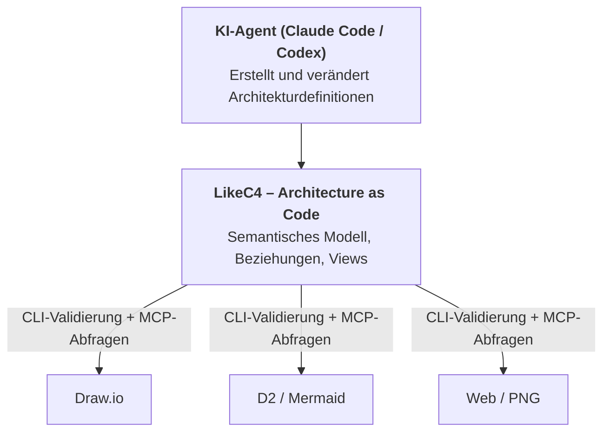
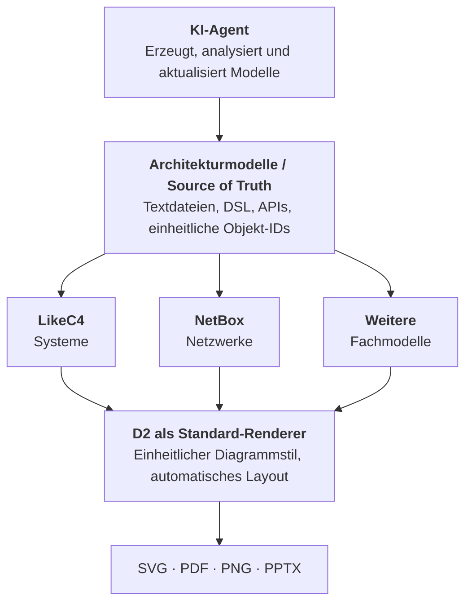

# Open Source Architektursoftware

- Source: https://chatgpt.com/share/6ae2764f-3b18-83ed-b183-152641793892
- Created: 2026-10-28 23:25
- Model: gpt-6-thinking

---

## User

Gibt es freie Open source Software für Architektur Zeichnungen die für ki Agenten besonders gut geeignet ist?

## ChatGPT

Ich vergleiche vor allem textbasierte Diagrammwerkzeuge, die KI-Agenten direkt bearbeiten, validieren und über eine CLI rendern können. Dabei prüfe ich auch Lizenz und Exportmöglichkeiten.

Ja. Es gibt mehrere **kostenlose Open-Source-Werkzeuge, die sich sehr gut für KI-Agenten eignen**, insbesondere für Software-, Cloud- und Infrastrukturarchitekturen.

Ich würde dabei klar auf **Architecture as Code** setzen: Der Agent erstellt und verändert eine textbasierte Architekturdefinition, die Software generiert daraus Diagramme. Das ermöglicht Git-Versionierung, automatische Validierung und CI/CD-Integration.

### Die 6 interessantesten Lösungen

| Software | Schwerpunkt | KI-Agent-Eignung* | Lizenz |
|---|---|---|---|
| LikeC4 | Softwarearchitektur, C4, Architekturmodelle | Sehr hoch | MIT |
| D2 | Flexible, ansprechende Architekturdiagramme | Sehr hoch | MPL-2.0 |
| Mermaid | Technische Dokumentation, Flows, Sequenzen | Hoch | MIT |
| Structurizr | Formale C4-Architekturmodelle | Sehr hoch | Open Core |
| Diagrams | AWS, Azure, Kubernetes, Cloud-Infrastruktur | Hoch | MIT |
| PlantUML | UML, Sequenz-, Komponenten- und Deploymentdiagramme | Hoch | GPL, alternative Editionen |

**Meine qualitative Einschätzung anhand von DSL, CLI, Automatisierung und Modellierungsfunktionen; kein gemessener KI-Benchmark. Quellen: offizielle Projektdokumentationen.*

### Meine drei Favoriten

**1. LikeC4 – Architekturmodelle mit KI-Agenten**

Besonders interessant, weil es bereits einen eigenen MCP-Server und Agent Skills mitbringt. Außerdem: DSL, CLI, Validierung, unterschiedliche Views und Export nach Draw.io, Mermaid oder D2.

[Website und Dokumentation](https://likec4.dev/)

**2. D2 – Freie Architekturzeichnungen**

Deklarative, vergleichsweise kompakte Syntax und automatisches Layout. Unterstützt SVG, PNG, PDF und PPTX. Gut für Diagramme, bei denen Flexibilität und Darstellung wichtiger sind als ein formales Architekturmodell.

[Website und Dokumentation](https://d2lang.com/)

**3. Diagrams – Cloud und Infrastruktur**

Python-basierte Definitionen mit Symbolen für Azure, AWS, GCP, Kubernetes und On-Premises. Besonders geeignet, wenn Agenten konkrete technische Infrastruktur visualisieren sollen. Benötigt Graphviz zum Rendern.

[Website und Dokumentation](https://diagrams.mingrammer.com/)

### Empfehlung für einen Agenten-Workflow

Für eine Architektur, die KI-Agenten selbstständig erstellen und weiterentwickeln sollen, würde ich **LikeC4 als primäres Architekturmodell** wählen.



Ein Agent könnte damit Änderungen vornehmen und anschließend automatisiert validieren:

```bash
likec4 validate
likec4 export drawio -o ./diagrams
```

Die beiden Befehle sind offiziell dokumentiert. Der MCP-Server ermöglicht zusätzlich strukturierte Architekturabfragen und Diagramm-Previews.

**Meine Auswahl wäre daher:**

- **LikeC4**, wenn die Architektur langfristig konsistent bleiben und von Agenten verstanden werden soll.
- **D2**, wenn du primär schöne, flexible Diagramme generieren möchtest.
- **Diagrams**, wenn du vor allem detaillierte Azure-/Kubernetes-Infrastruktur visualisieren möchtest.

Eine wichtige Einschränkung: Structurizr besitzt ebenfalls leistungsfähige C4- und KI-Funktionen, verfolgt inzwischen aber ein Open-Core-Modell. Der Server benötigt bei Nutzung der vorgefertigten Binaries eine kostenpflichtige Lizenz; die anderen dokumentierten Commands sind frei und Open Source.

Für deinen Schwerpunkt auf KI-Agenten finde ich **LikeC4 besonders spannend, weil es Architektur nicht nur zeichnet, sondern als maschinenlesbares Modell bereitstellt**. Das ist der entscheidende Unterschied gegenüber einem reinen Diagrammgenerator.

## User

Auch für Netzwerke

## ChatGPT

Ja, auch für Netzwerktopologien. Ich prüfe zusätzlich, welche Werkzeuge VLANs, Subnetze, Routing, Firewalls und Verbindungen gut darstellen können – und welche sich durch Agenten zuverlässig automatisieren lassen.

Ja. **Auch für Netzwerkarchitekturen**, einschließlich Layer 2/3, VLANs, Subnetzen, Firewalls, Routing und VPNs.

Für Netzwerke würde ich die Auswahl allerdings etwas anders priorisieren als für Softwarearchitektur.

| Werkzeug | Eignung für Netzwerke | KI-Agenten |
|---|---|---|
| D2 | Netzwerkdiagramme, Zonen, Verbindungen, IP-Beschriftungen | Sehr gut, deklarative DSL und CLI |
| Diagrams | Router, Switches, Firewalls, Azure-Netzwerke | Sehr gut, Python API |
| N2G | Physische und logische Netzwerktopologien | Sehr gut, Netzwerkdaten zu Diagrammen |
| NetBox + Topology Views | VLANs, IPAM, Interfaces, Verkabelung, VRFs | Sehr gut, REST API |
| LikeC4 | Netzwerkarchitektur auf abstrakter Ebene | Gut, weniger für detaillierte L2/L3-Topologien |

Die Einordnung basiert auf den dokumentierten Funktionen, nicht auf KI-Benchmarks.

### Zwei besonders interessante Optionen

**D2 – für das Zeichnen**

Agent erzeugt Text, D2 rendert das Diagramm. Besonders unkompliziert für Netzwerkdesigns, die du in Git verwalten möchtest. Unterstützt unter anderem SVG-, PNG- und PDF-Export.

[d2lang.com](https://d2lang.com)

**NetBox – für echte Netzwerkmodelle**

Speichert strukturierte Netzwerkdaten: Geräte, Interfaces, VLANs, IP-Adressen, VRFs und Verkabelung. Über die REST API können Agenten diese Daten verwalten. Das Open-Source-Plugin Topology Views visualisiert die Verbindungen.

[Topology Views auf GitHub](https://github.com/netbox-community/netbox-topology-views)

### Meine Empfehlung

Wenn du möchtest, dass ein Agent beispielsweise eine Netzwerktopologie mit Firewalls, Switches, VLANs, Subnetzen und VPN-Verbindungen erzeugt, würde ich **D2 bevorzugen**.

Wenn der Agent dagegen ein Netzwerk technisch korrekt modellieren und die Daten anschließend für Automatisierung verwenden soll, würde ich **NetBox als Source of Truth und D2 als Visualisierung** kombinieren.

Wichtig ist der Unterschied: Ein Diagramm mit eingezeichneten VLANs oder Routen ist noch kein validiertes Netzwerkmodell.

Mich würde dazu eine Unterscheidung interessieren: Geht es dir hauptsächlich um **Architekturzeichnungen für Dokumentation und Planung**, oder sollen die Agenten auch **technisch auswertbare Netzwerktopologien** erstellen?

## User

Gibt es eine Software, die alle Architekturen abbilden kann? Oder wäre es besser für jede Architektur jeweils das beste Tool auszusuchen?

## ChatGPT

**Meine Empfehlung wäre ein hybrider Ansatz:** Ein gemeinsames Werkzeug für die meisten Architekturdiagramme und spezialisierte Werkzeuge dort, wo fachliche Modellierung oder Validierung erforderlich ist.

Es gibt durchaus Open-Source-Software, die praktisch jede IT-Architektur *zeichnen* kann. Aber keine der untersuchten Lösungen modelliert alle Architekturdomänen gleichermaßen detailliert und fachlich korrekt.

### 1. Welche Software kann möglichst viel abdecken?

| Software | Abdeckung | Eignung für KI-Agenten | Hauptschwäche |
|---|---|---|---|
| D2 | Nahezu alle Arten von Diagrammen | Sehr hoch | Keine domänenspezifische Semantik |
| draw.io | Nahezu alle Arten von Diagrammen | Mittel | Visueller Editor, XML für Agenten aufwendiger |
| Archi | Unternehmens-, Anwendungs-, Technologiearchitektur | Mittel | Automatisierung weniger unkompliziert |
| LikeC4 | Software-, System- und abstrakte Infrastrukturarchitektur | Sehr hoch | Kein spezialisiertes Netzwerkmodell |

Alle vier sind kostenlos und Open Source. D2 und draw.io bieten besonders flexible Zeichnungsfunktionen; Archi und LikeC4 arbeiten stärker modellorientiert.

Interessant ist insbesondere **Archi mit ArchiMate**: Damit lassen sich Geschäftsprozesse, Anwendungen und Infrastruktur einschließlich ihrer Beziehungen in einem gemeinsamen Architekturmodell darstellen. Es ist für Enterprise Architecture umfassender als C4. Allerdings ist die Agentenautomatisierung weniger direkt; das offizielle jArchi-Scripting-Plugin wird über eine Patreon-Mitgliedschaft bereitgestellt.

### 2. Meine bevorzugte Architektur für KI-Agenten

Ich würde nicht für jede Diagrammart ein vollständig unabhängiges Werkzeug etablieren. Stattdessen würde ich drei Ebenen trennen:



*Konzeptioneller Aufbau. Für den Export spezialisierter Modelle nach D2 können eigene Konverter notwendig sein.*

D2 unterstützt diese Ausgabeformate über seine CLI.

### 3. Wann würde ich spezialisieren?

| Architekturdomäne | Meine Wahl |
|---|---|
| Überblick / High-Level | D2 oder LikeC4 |
| Software / Microservices | LikeC4 |
| Azure / AWS / Kubernetes | D2, ggf. Diagrams |
| Netzwerke, VLANs, IPAM | NetBox |
| Enterprise Architecture | Archi / ArchiMate |
| UML / detaillierte Softwaremodelle | PlantUML |
| Security-Zonen / Datenflüsse | D2, bei Bedarf spezialisiertes Modell |

### 4. Entscheidender Punkt: Ein Diagramm ist kein Architekturmodell

Angenommen, ein KI-Agent zeichnet:

`Application → Firewall → Database`

Ein gewöhnliches Diagrammwerkzeug weiß nicht, ob die Verbindung technisch erlaubt ist, welcher Netzwerkpfad verwendet wird oder welche Firewallregel gelten muss.

Ein fachliches Modell könnte dagegen diese Informationen enthalten und gegen definierte Regeln prüfen.

Darin liegt aus meiner Sicht der eigentliche Mehrwert für KI-Agenten: **Nicht nur Architekturdiagramme generieren, sondern aus strukturierten Architekturinformationen verschiedene Ansichten ableiten.**

Deshalb würde ich mit **D2 als universellem Standard** anfangen und nur dann spezialisierte Werkzeuge hinzufügen, wenn sie einen echten semantischen Mehrwert bieten.

Für einen vollständig agentenbasierten Workflow würde ich außerdem einheitliche IDs, Modellkonventionen, Validierungsregeln und CI-Checks festlegen. So vermeidest du, dass verschiedene Diagramme dieselbe Architektur widersprüchlich darstellen.

**Eine wesentliche Frage für die endgültige Werkzeugwahl:** Sollen deine KI-Agenten ausschließlich Architekturdiagramme für Dokumentation und Präsentationen erzeugen, oder sollen sie auch ein dauerhaftes, technisch auswertbares Architekturmodell pflegen, aus dem sich beispielsweise Abhängigkeiten, Sicherheitsregeln und Änderungen analysieren lassen?

---

If you want, I can:

- Bitte ausführliche Empfehlungen für ein KI-gestütztes Architekturmodell mit LikeC4 geben
- Vergleiche Tools für Netzwerke und Softwarearchitektur für KI-Agenten
- Beschreibe einen typischen Agenten-Workflow zur Architekturdiagramm-Generierung mit mehreren Tools
