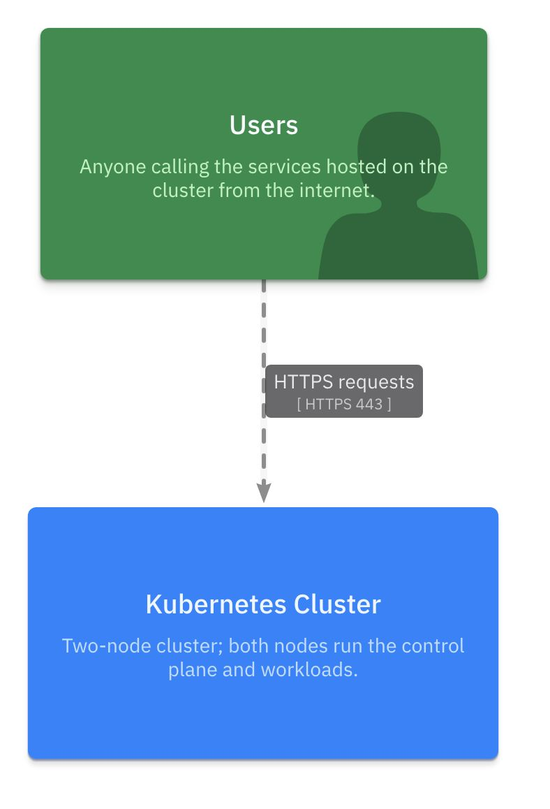
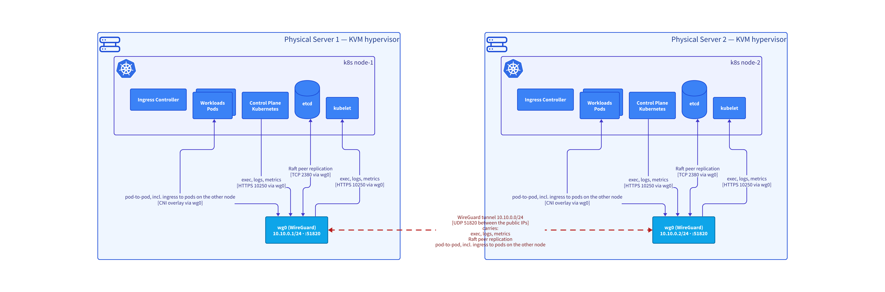

# Architecture diagrams

> Generated by `architecture-kit render`; do not edit.

## Kubernetes cluster over WireGuard (example)

Project `k8s-cluster`

### Landscape and cross-cutting views

#### Overview

Who uses the cluster. Details in the network and component views.

View `index`

### Systems (containers)

#### Kubernetes — Components on Each Node

What runs on every node and how the components talk to each other locally.

View `clusterComponents`

### Infrastructure and network

#### Cluster-internal Traffic

All Kubernetes components on both nodes; only traffic that crosses the WireGuard tunnel.

View `clusterTraffic`

#### Network — Servers, VMs and Kubernetes Nodes

Hardware and virtual NICs, public ingress along internet → NIC → eth0 → ingress (grey), and cluster-internal traffic (indigo) entering the WireGuard tunnel (red) on each node.

View `network`

