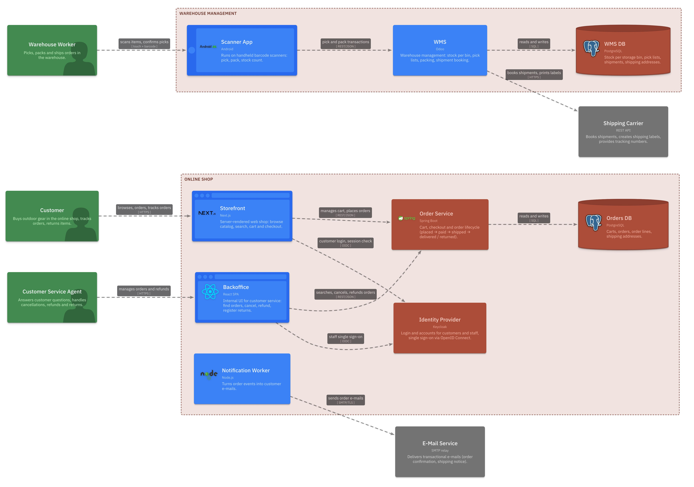
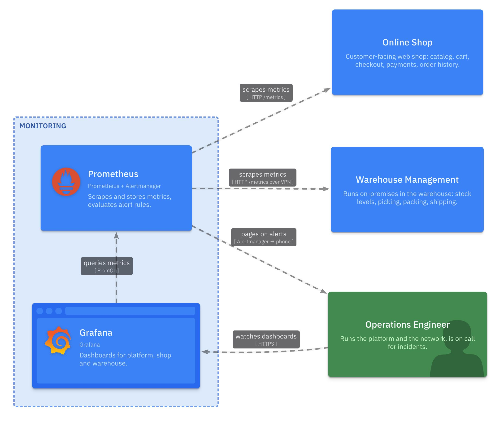
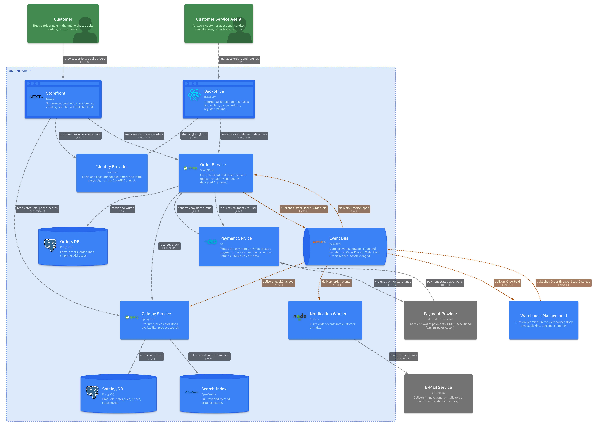
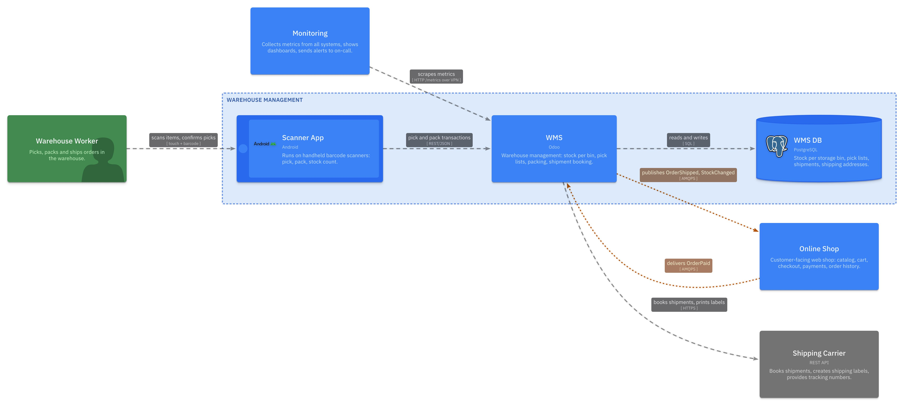
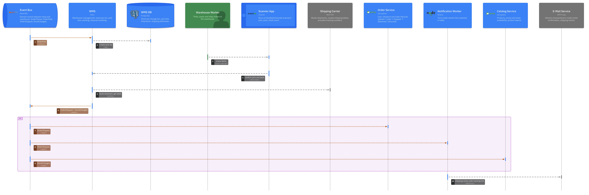
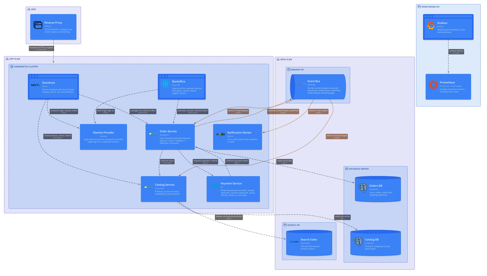
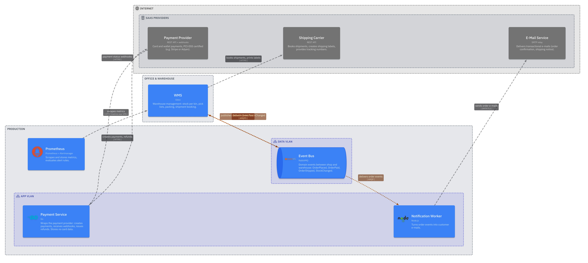
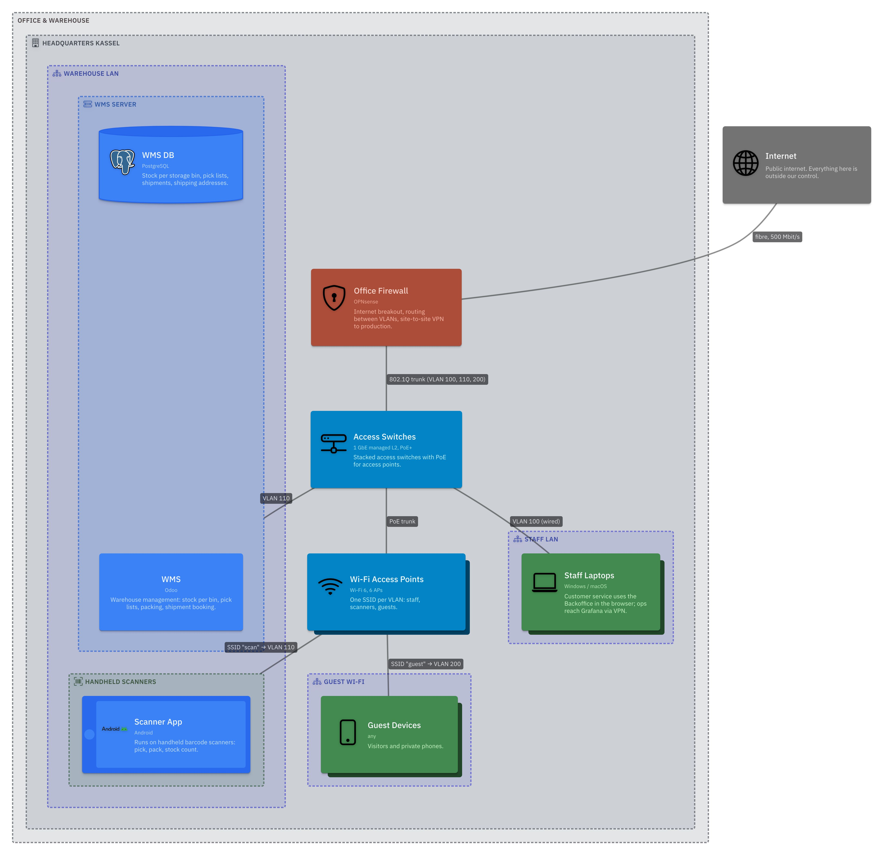
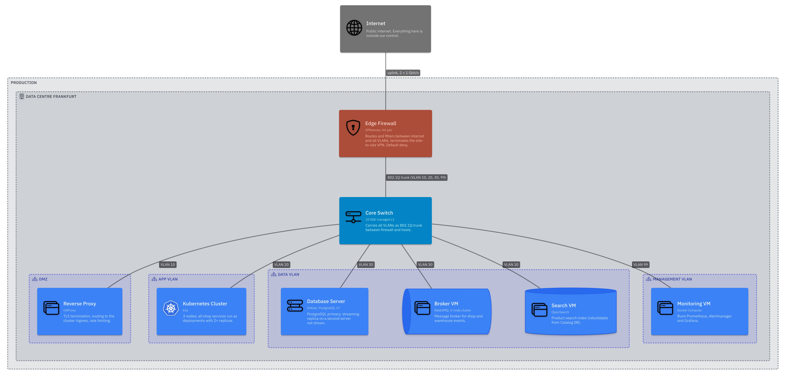
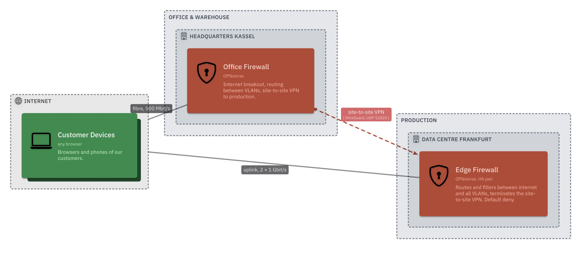

# Architecture diagrams

> Generated by `npm run render`; do not edit. Each image is rendered from the model in `model/`.

## Landscape and cross-cutting views

### System Landscape

All people, our systems and the external systems they depend on.

View `index`

### Personal Data (GDPR)

Where personal data (names, addresses, orders) flows. Elements tagged #pii (red) own or store it.

View `personalData`

## Systems (containers)

### Monitoring — Containers

What is monitored and how alerts reach the on-call engineer.

View `monitoringContainers`

### Online Shop — Containers

Deployable parts of the shop and how they talk to each other and to the outside.

View `shopContainers`

### Online Shop — Context

Who uses the shop and which systems it depends on. Internals hidden.

View `shopContext`

### Online Shop — Event Flows

Only asynchronous messages over the event bus: who publishes and who consumes.

View `shopEvents`

### Warehouse Management — Containers

On-premises warehouse system and its integration with the shop and the carrier.

View `warehouseContainers`

## Scenarios (sequence)

### Scenario — Checkout and Payment

From "Buy now" to the confirmation e-mail and the paid order arriving in the warehouse.

View `checkout`

### Scenario — Picking and Shipping

From a paid order to the customer receiving the shipping notice.

View `fulfilment`

## Infrastructure and network

### Deployment — Production

Which software runs on which host in which VLAN, and the traffic between them.

View `prodDeployment`

### Deployment — Traffic Between Sites

Logical connections that leave a site: through the VPN or to the internet.

View `crossSiteTraffic`

### Network — Office & Warehouse

Office VLANs, Wi-Fi, cabling and which software runs on-premises.

View `officeNetwork`

### Network — Production Data Centre

VLANs, subnets and hosts in the data centre and how they are cabled. No software shown.

View `prodNetwork`

### Network — Sites and WAN

Both sites, their internet uplinks and the site-to-site VPN.

View `sites`

